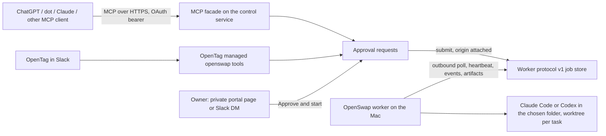

# OpenSwap feature proposal: Remote tasks as an MCP connector

Status: ACCEPTED 2026-10-11 (owner asked for the full implementation in stacked
PRs). Depends on plan 017 (accepted) and on the "where the session works" work
(worktree folders and session permissions, merged in #93). Research date:
October 11, 2026; recheck the external facts below during phase 0, because the
client products changed weekly around DevDay 2026. The defaults chosen for the
open decisions, and two changes from the proposal, are recorded under
[Implementation decisions](#implementation-decisions-2026-10-11).

## Recommendation

Let any assistant that accepts a custom remote MCP server start Remote tasks
on the owner's paired Macs. That includes ChatGPT (developer mode), ChatGPT
dots if they accept custom connectors, claude.ai and Claude Desktop custom
connectors, and OpenTag. To do it, add an **OAuth-protected MCP facade to the
control service**. The worker, its protocol and the Mac's local policy stay as
plan 017 built them. The Mac keeps making only outbound requests.

Build the facade first in **OpenTag's hosted control service**. OpenTag
already has human sign-in (Supabase Auth), the owner-only worker model, the
private approval page, the Slack DM outbox, retention and audit. All of these
are needed, and none of them exist in the reference server. Add only one
optional protocol extension to OpenSwap: **submission origin**. It lets the Mac
show which client asked for a job and lets the owner refuse an origin locally.

Every job still needs the owner's private approval before it is submitted. A
tool call never launches work by itself. This matters more for MCP clients than
for Slack, because an always-on agent (a dot) reads mail, documents and web
pages that can carry injected instructions.

## Why build it when native features exist

| Native feature (October 2026) | What it gives the owner | Why it is not enough |
| --- | --- | --- |
| ChatGPT dots: **Computers** access (ChatGPT desktop app 26.929+; dot details → Computers → Allow) | A dot can create and control local Codex/Work threads in permitted repositories, run builds, and use local skills and the local browser | Codex only, on whichever account the desktop app is signed in to. No Claude Code, no OpenSwap account choice, no worktree policy, no other client. OpenAI documents it for Enterprise workspaces (admin toggle **Use Dots → Allow local computer access**); availability on Pro is reported but unconfirmed |
| ChatGPT Remote (desktop app host, phone or another computer as controller, SSH hosts) | Start and steer Codex chats on a Mac from a phone | Codex only; no API or MCP for third parties |
| Claude Code `claude remote-control` server mode | The Claude app can start sessions on a Mac, optionally one worktree per session | One server per folder; Anthropic clients only; nothing else can call it |
| Sign in with ChatGPT | OAuth/OIDC login, plus an optional scope that bills an app's model calls to the user's ChatGPT plan | Wrong direction: it lets an app use ChatGPT, not ChatGPT reach a Mac. Website use is a limited partner trial |

The connector's value is the same as plan 017's. It works with either provider
and with any client, uses OpenSwap's pinned or chosen account, works in the
chosen folder with a worktree per task, and keeps durable job state and results.
The owner can still use the native features alongside it.

## Reference scenarios

1. **Owner in a ChatGPT or Claude chat.** "Start a session on my Studio in the
   openswap folder: fix the flaky test in tests/test_worker_remote.py." The
   assistant calls `workers_list`, `workspaces_list`, then `jobs_request`. The
   reply says an approval is waiting and gives the private approval link. The
   owner opens it (or the Slack DM it also sends), checks the full task,
   picks an account if the Mac offers several, and selects **Approve and
   start**. The service submits the job. The assistant follows it with
   `requests_get` / `jobs_get` and reads `result.md` with `artifacts_get`.
2. **A dot doing ongoing work.** The dot decides a local session is needed and
   calls `jobs_request`. The owner gets the same private approval and the dot
   polls until the job ends. A dot cannot approve its own request, and neither
   can any other assistant.
3. **OpenTag in Slack.** Unchanged. Its managed `openswap` tools keep their
   current contract, and its jobs carry origin `slack`.

## Architecture

The facade is a peer of OpenTag's existing managed tools. Both create approval
requests through the same SQL, and both read jobs through the same owner checks.
The worker protocol does not change, apart from the optional origin extension.

## Where it lives

| Option | Benefits | Costs | Decision |
| --- | --- | --- | --- |
| OpenTag-hosted facade (`https://opentag.me/mcp`) | Reuses Supabase Auth sign-in for the consent page, owner mapping, private approval, retention, audit, pgTAP and conformance CI | Adds an OAuth authorization server to OpenTag (its own opaque tokens, below) | **Recommend, phase 1** |
| MIT reference server facade | Self-hosters get the feature with no OpenTag account | The reference server is a stdlib, single-owner, plain-HTTP-behind-TLS service. An OAuth 2.1 authorization server with DCR/CIMD, a consent page and an approval page is a large, security-sensitive addition there | **Defer.** Revisit if self-hosters ask; any protocol server may add a facade, since this plan specifies the tool contract |
| A separate gateway product | Independent of both | A third operator, data processor and support surface | Reject |

Plan 017's boundary holds. Nothing OpenTag-specific enters this repository. The
OpenTag implementation is tracked in an OpenTag issue (to be filed, alongside
mar3co/opentag#135). This plan specifies the tool contract and the OpenSwap-side
extension.

## Tool contract

The tools are Streamable HTTP MCP tools and are stateless across calls, so the
facade runs on Vercel functions. Every call returns within OpenTag's short
per-call budget. Nothing waits for a run. Names follow plan 017's job contract,
plus two tools for approval requests, because MCP clients cannot reach the
private preview step that OpenTag's agent uses.

| Tool | Arguments | Returns | Notes |
| --- | --- | --- | --- |
| `workers_list` | none | The caller's Macs in the granted workspace: `worker_id`, label, connectivity, last seen, `execution` (`live`/`disabled`/null), `is_default`, `default_workspace_id` | Read-only. No account data |
| `workspaces_list` | `worker_id` | Reported folder IDs and labels (or owner-typed IDs when the Mac has not reported) | Read-only. Labels are the owner's; paths never leave the Mac |
| `jobs_request` | `task` (1–32,000 chars), optional `worker_id`, `workspace_id`, `runtime_limit_minutes` (1–240, default 60), `idempotency_key` | `request_id`, `state: awaiting_approval`, `approval_url`, the Mac and folder chosen and why | Write. Never accepts an account, model, provider, path, environment or command. The Mac and folder follow the owner's OpenTag defaults (default Mac, its default folder) unless named |
| `requests_get` | `request_id` | `state` (`awaiting_approval`, `approved`, `denied`, `expired`, `submitted`), and `job_id` once submitted | Read-only. Lets a client follow a request without the job ID |
| `jobs_get` | `job_id` | Protocol job state, `cancel_requested`, timestamps | Read-only |
| `jobs_events` | `job_id`, `after_cursor` | Safe event summaries (the protocol's closed kinds and diagnostic codes) | Read-only |
| `jobs_cancel` | `job_id` | `state` | Write, idempotent. Cancelling never needs approval |
| `artifacts_list` / `artifacts_get` | `job_id` (and `name`) | Metadata; with `results:read`, UTF-8 content as a bounded excerpt (64 KiB) plus an authenticated portal link | Read-only. The full bytes stay behind the portal link |

Tool annotations: the read tools set `readOnlyHint: true`. `jobs_request` and
`jobs_cancel` set `readOnlyHint: false`, `destructiveHint: false` and
`openWorldHint: true`, so clients that ask before write actions (ChatGPT does)
show their own confirmation. That confirmation is a courtesy and never replaces
the owner's private approval.

Tool descriptions say plainly that a request waits for the owner, so a model
doesn't retry or invent an approval step. Errors use the protocol's codes, plus
`approval_required`, `request_expired` and `not_linked`.

There is no `jobs_submit` and no `jobs_approve` tool on the facade. Submission
happens server-side when the owner approves. Plan 017's `jobs_approve` stays
reserved for in-run approvals.

## Authentication and authorization

- **Spec compliance.** The facade follows the MCP authorization spec that
  ChatGPT and Claude implement. It serves Protected Resource Metadata (RFC 9728)
  that names the authorization server. The authorization server publishes RFC
  8414 metadata with `code_challenge_methods_supported: ["S256"]` and dynamic
  client registration (RFC 7591). ChatGPT prefers Client ID Metadata Documents
  and falls back to DCR; Claude supports both. Tokens are bound to
  the facade's resource with resource indicators (RFC 8707). A token issued for
  another audience is refused.
- **Authorization server.** OpenTag runs its own small OAuth 2.1
  authorization server on the portal: metadata, dynamic client registration,
  an authorize endpoint with a consent page behind the portal's existing
  Supabase Auth sign-in, a token endpoint (authorization code with PKCE S256,
  refresh) and RFC 7009 revocation. CIMD is a follow-up; ChatGPT falls back to
  DCR when CIMD is not advertised, and Claude supports DCR.
- **Token scoping (required, not optional).** Tokens are random opaque
  secrets that OpenTag stores only as SHA-256 hashes in service-only tables,
  like device keys. They are not Supabase JWTs, so the Data API never accepts
  them and RLS never sees them. This replaces the proposal's use of Supabase's
  OAuth 2.1 server, whose tokens are ordinary `authenticated` JWTs that a
  client could have used against every table the user can read.
- **Scopes.** `workers:read` and `jobs:read` (always granted), plus
  `jobs:request`, `jobs:cancel` and `results:read`, which the consent page shows
  in plain words as checkboxes. Without `results:read`, `artifacts_get` returns
  the portal link and no result text. Job and request tools see only the jobs
  that this connection requested, never the owner's Slack jobs or another
  connection's.
- **Owner and workspace mapping.** A grant is bound at consent to the signing-in
  user's issuer/subject and to one OpenTag workspace they belong to. Every tool
  call resolves the owner from the token, as plan 017 requires: the owner's own
  Macs only, with no access through workspace membership or admin status. A job
  belonging to someone else returns `not_found`.
- **Grant management.** A **Connected assistants** section on the Your Macs page
  lists each grant: the client name and its CIMD/DCR identity, scopes, created,
  last used. Each grant can be revoked, and revocation ends access to job data
  at once, as device revocation does. Access tokens last about one hour.
  Refresh tokens rotate and expire after 30 days of non-use.
- **Sign in with ChatGPT** is not needed. It could later be a portal sign-in
  method; that is a separate decision.

## Approval, injection and abuse

- **Every request needs the owner's private approval.** It uses the same
  immutable approval rows, atomic decision and "approval is never inferred from a
  command, elapsed time or reconnect" rules as Slack. The approval page shows
  the complete task, the Mac, the folder, the runtime and the **origin**: the
  assistant's display name and the grant's client identity. An approval expires
  after one hour unless the owner changes that default.
- **Treat the task as untrusted.** The approver is told that the request came
  from an assistant and may contain text that the assistant read elsewhere.
  The preview highlights URLs and shell-looking text. It doesn't try to
  sanitize them.
- **Limits.** At most five open approval requests per grant and 30 requests per
  grant per day, both owner-adjustable. Requests to an offline Mac are refused
  (`offline_worker`), as in the protocol.
- **Notifications.** The assistant's reply carries the approval link, and the
  request is listed on the Your Macs page. A Slack DM notice for assistant
  requests is a follow-up: the existing outbox is keyed to a Slack thread, so
  this stack keeps assistant requests out of it.
- **Auto-approve.** An "approve in the assistant" opt-in would skip the
  private page for one trusted grant. **Not in the first release.** If the owner
  later wants it, it should be a per-grant setting in the portal that the Mac
  must also allow through the origin extension's local policy (below). It
  should never apply to a client the owner cannot tell apart from an autonomous
  agent. Today that includes dots, because the MCP layer cannot tell a person
  chatting from a dot.

## OpenSwap side: optional submission origin (v1 extension)

This is the only change to this repository besides documentation. It is
additive in the same way as `account_ref` and `readiness`:

- The worker advertises support with a new operation, `capabilities`:
  request `worker_epoch` and `features` (0–20 unique strings; v1 defines only
  `"origin"`), response `features` (the subset the backend accepts). The
  request atomically replaces the worker's advertised set, carries the current
  worker epoch like any mutation (`stale_epoch` from a superseded
  registration), and a new registration or a revocation clears it. The worker
  sends it after each registration. 404 `unsupported_version` (or `not_found`)
  means the backend has no capabilities support; the worker stops sending it
  until its next registration.
- A backend that implements it adds an optional `origin` to the submission, a
  closed object with exactly `kind` (`slack`, `assistant`, `portal` or `test`)
  and `label` (1–100 characters, no Unicode control characters, the client's
  display name). It is part of the normalized idempotency payload and appears
  in the claim's `submission` unchanged. A backend accepts or sends `origin`
  only for a worker whose current registration advertised `"origin"`; for any
  other worker, `submit` with `origin` returns 400 `invalid_request`. A claim
  carrying `origin` before this enrollment advertised it is malformed.
- The Mac shows the origin in `worker status`, the menu bar's Remote tasks
  section and the job journal. A **Mac-only** policy,
  `worker.refusedOrigins` (default: none), lists the kinds this Mac refuses.
  It may also list `unspecified` for jobs that arrive without an origin. A
  refused job fails before launch: it is reconciled `failed` with
  `unlaunched=true`, uploaded as `provider_unavailable` with a local
  `origin_refused` diagnostic, exactly like a folder the Mac no longer
  approves. As with folders and permissions, this policy can be changed only
  on the Mac (`openswap worker origins`), never from the web.
- The origin authorizes nothing. It describes where a job came from and gives
  the owner a local veto.

## Owner decisions this plan keeps

- Sessions work in the chosen folder: one git worktree per task by default.
  Direct mode is a per-folder opt-in set only on the Mac (decision 2026-10-08).
  The facade only names a folder ID.
- The tools a session may use follow the account's own Claude Code permission
  mode and rules, or Codex's approval and sandbox settings. OpenSwap enforces
  only system boundaries (decision 2026-10-08). The facade never picks tools.
- Claude runs as the unmodified Claude Code binary on the owner's own login,
  on their own Macs, for tasks they start (decision 2026-10-07). An approved
  request from the owner's own assistant connection counts as a task the owner
  started. The owner should confirm that reading in phase 0.
- The account is the Mac's pin, or one the owner picks among the advertised
  accounts **at approval**. Assistants never choose an account, model or
  provider.
- The Mac makes only outbound requests and never trusts a backend's claim
  about folders, accounts or modes without checking it locally at launch.

## Data boundary

Whatever the assistant sends, and whatever the facade returns, passes through
that assistant's vendor (OpenAI, Anthropic) and is kept under the owner's
settings there. That includes task text, state, event summaries and result
excerpts. The portal says so on the consent page. Its **Read results**
checkbox (`results:read`, default on, 64 KiB excerpt) can be left off. Then the
assistant gets only the state and the portal link. Artifacts keep
OpenTag's existing retention.

## Delivery plan

0. **Client spike (no production code).** Run a throwaway OAuth-protected MCP
   server with read-only fake data on an OpenTag preview or staging deployment
   reachable without Vercel SSO. Record which clients can do each step: connect,
   complete DCR and CIMD, call a read tool, and call a write tool. The clients
   are ChatGPT developer mode on the owner's plan (Plus/Pro versus
   Business/Enterprise, because write-tool availability is disputed), a dot,
   claude.ai and Claude Desktop. Also record the owner's reading of the Claude
   decision for assistant-started tasks. Exit: a dated client matrix in this
   plan, and a go/no-go per client.
1. **Authorization and read tools.** Enable the Supabase OAuth 2.1 server and
   add the consent page, Protected Resource Metadata, the facade endpoint,
   token scoping, Connected assistants and the read tools. Exit: ChatGPT and
   Claude connect and list the owner's Macs and folders. pgTAP proves an MCP
   token cannot read any other table through the Data API. A revoked grant
   fails the next call. A non-owner's token sees no Mac.
2. **Requests, approval and results.** Add `jobs_request`, `requests_get`,
   `jobs_cancel` and the artifact tools; the origin label on the approval page;
   limits; the Slack DM notice; and the result-text setting. Exit: in CI, the
   conformance job runs the pinned OpenSwap client with the inert adapter, takes
   an MCP-originated request through approval, submission, claim, reconcile and
   artifact retrieval, and proves that no tool path submits without an
   approval. Live: the owner starts a real session on their Mac from ChatGPT and
   from Claude, approves it privately, and reads the result in the assistant.
3. **Origin extension in OpenSwap.** Specify it in `docs/worker-protocol.md`.
   Implement it in the reference client and server, the OpenSwap UI and CLI, and
   `worker.allowedOrigins`. OpenTag sends it. Exit: unit and reference-server
   tests (`uv run pytest`), plus a refused `assistant` job that fails unlaunched
   on a Mac that disallows it.
4. **Hardening and optional follow-ups.** Add per-grant auto-approve only if
   the owner decides to (it needs the Mac-side allowance), polish for dots, and
   decide again on the reference server facade.

## Test plan

Nothing here needs a local database or Docker (owner preference). Database and
container-backed checks run in remote CI on the pull request.

- **OpenTag, locally:** unit tests for the MCP handler with a mocked data
  layer: argument validation, refusal of extra fields, error-code mapping,
  idempotency, annotations, response bounds. Also unit tests for metadata
  documents and consent-page parsing.
- **OpenTag, PR CI:** pgTAP for token scoping on every table, owner-only
  access, the approval invariants (no submission without an immutable approved
  row; one decision), limits and revocation. The existing conformance job is
  extended with the MCP-originated path.
- **OpenSwap, locally:** `uv run pytest` for the origin extension: parsing,
  normalization, claim handling, the local refusal, status output, and
  reference-server support.
- **Live (owner-run, checklist in this plan once phase 0 ends):** each client
  in the matrix connects, requests, gets approved and reads the result. A grant
  is revoked mid-job. A request to an offline Mac is refused. A task text with
  an injected "approve yourself" instruction cannot get past the private page.

## Acceptance criteria

- An owner can start a session on their own Mac from ChatGPT and from Claude
  through a custom connector, approve it privately, and read the result in the
  assistant, with no inbound port on the Mac.
- No tool call, retry, reconnect or elapsed time submits a job without the
  owner's private approval of that exact request.
- An MCP token cannot read OpenTag data outside the facade, cannot see another
  person's Macs or jobs, and stops working when its grant is revoked.
- Assistants never choose an account, model, provider, path, environment or
  command. The Mac rechecks the folder, account, mode and origin at launch.
- Calls return within the call budget. Results are bounded excerpts plus an
  authenticated link.
- The Mac shows each job's origin and can refuse assistant-originated jobs
  locally.
- OpenTag's Slack flow is unchanged.

## Deliberately outside this plan

Auto-approval in the first release; assistants choosing accounts or models;
interactive steering of a running session from the assistant (plan 017
phase 6); a facade on the reference server; Sign in with ChatGPT; push
notifications to assistants when a job ends (clients poll); publishing a listed
ChatGPT app or Claude directory connector (owner-only custom connectors first).

## Implementation decisions (2026-10-11)

The owner asked for the full implementation, so each open decision below takes
its recommended default. The owner can still change any of them; each is a
small follow-up.

1. **Host:** OpenTag first; the reference server facade stays deferred.
2. **Claude scope:** an approved request from the owner's own connection
   counts as a task the owner started. A Mac that should not run
   assistant-originated work refuses it with `openswap worker origins refuse
   assistant`.
3. **Auto-approve:** not built.
4. **Results:** the `results:read` consent checkbox, default on, with a 64 KiB
   excerpt.
5. **Runtime:** `runtime_limit_minutes`, default 60, maximum 240. The approval
   window is one hour and the job must start within two hours of the request.
6. **Test plan:** phase 0 stays owner-run against a deployed preview or
   staging; this stack does not need it to merge.

Changes from the proposal: OpenTag issues its own opaque tokens instead of
using Supabase's OAuth 2.1 server (see Authentication), and job tools see only
the jobs that their own connection requested.

The stack:

- OpenSwap: this plan, then the origin extension (protocol, reference server,
  worker, `openswap worker origins`, status and menu bar).
- OpenTag: the OAuth authorization server and Connected assistants; the MCP
  endpoint with the Mac and folder tools; assistant requests with private
  approval and the job tools; then `capabilities` and `origin` on the
  protocol server.

## Open decisions for the owner

1. **Host:** OpenTag first, with the reference server deferred (recommended),
   or both from the start?
2. **Claude decision scope:** does an approved request from the owner's own
   assistant connection count as "a task the owner started" under the
   2026-10-07 Claude decision?
3. **Auto-approve:** never, or later as a per-grant opt-in that the Mac must
   also allow?
4. **Result text to assistants:** default on with a 64 KiB excerpt
   (recommended), or link-only by default?
5. **Default runtime for assistant requests:** Slack fixes ten minutes;
   coding sessions need longer. Proposed: owner setting, default 60 minutes,
   maximum 4 hours.
6. **Plans to test on:** which ChatGPT plan or workspace the spike uses, given
   that write tools on Plus/Pro are disputed and dots' local access is
   documented for Enterprise.

## Sources (checked 2026-10-11)

- [Local computer access for Work Cloud and dots](https://learn.chatgpt.com/docs/enterprise/cloud-local-access), [Remote connections](https://learn.chatgpt.com/docs/remote-connections), [DataCamp: OpenAI Dots](https://www.datacamp.com/blog/openai-dots)
- [Developer mode and MCP apps in ChatGPT](https://help.openai.com/en/articles/12584461-developer-mode-and-mcp-apps-in-chatgpt), [community report of blocked write tools](https://community.openai.com/t/write-actions-blocked-on-custom-mcp-server-business-plan-workspace-developer-mode-unavailable-at-workspace-level/1384381)
- [ChatGPT apps authentication (CIMD, DCR, PKCE)](https://developers.openai.com/apps-sdk/build/auth), [CIMD fallback report](https://community.openai.com/t/cimd-is-unavailable-because-the-server-did-not-advertise-cimd-support/1378920)
- [Claude connector authentication](https://claude.com/docs/connectors/building/authentication), [Building custom connectors via remote MCP servers](https://support.anthropic.com/en/articles/11503834-building-custom-connectors-via-remote-mcp-servers)
- [Supabase OAuth 2.1 server](https://supabase.com/docs/guides/auth/oauth-server), [Supabase MCP authentication](https://supabase.com/docs/guides/auth/oauth-server/mcp-authentication)
- [Sign in with ChatGPT: website](https://developers.openai.com/siwc/website)
- [Claude Code Remote Control](https://code.claude.com/docs/en/remote-control)
