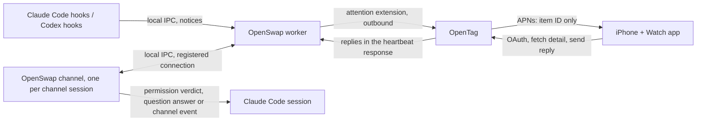

# OpenSwap feature proposal: know when any session needs you, on your watch

Status: IN PROGRESS. Accepted 2026-11-06 with every default (see
[Owner decisions](#owner-decisions-2026-11-06)). Every phase was built and
review-settled by 2026-11-07. Review records:
[S1](025-review-s1.md), [S2](025-review-s2.md), [O1/O2](025-review-o1-o2.md),
[A1/A2](025-review-a1-a2.md). Exits wait on the owner's live checks on real
devices (mar3co/openswap#184). Depends on plan 017 (worker, pairing, protocol),
plan 018 (OpenTag's OAuth server) and plan 022 (Connect to OpenTag). Facts
about Claude Code were checked against v2.1.311 and its docs
(`code.claude.com/docs/en/hooks`, `/channels`, `/channels-reference`) on
2026-11-06. Channels are a research preview, so recheck them in phase 0.

## Problem

The owner runs several Claude Code and Codex sessions at once, across more
than one Mac and more than one account. A session that stops to ask something
just waits. Today the owner finds out by looking:

- Claude Code's own desktop notification reaches only the Mac it runs on, and
  only when that Mac's notifications are on and seen.
- The Claude app's Remote Control follows only sessions started with Remote
  Control, on Anthropic's own clients.
- Codex reports a finished turn only to the one program named in its `notify`
  setting.

So a session can sit for an hour on "Allow `npm test`?" while the owner works
in another one. Answering it means walking back to that Mac.

## Recommendation

Build **session attention**. Every Claude Code session on a paired Mac reports
when it needs the owner (Codex sessions too, through Codex hooks). OpenTag sends a
push to the owner's iPhone and Apple Watch, and the owner can answer the common
cases with one or two taps.

1. **Notice (every Claude Code session).** OpenSwap installs Claude Code hooks
   in `~/.claude/settings.json`, beside its status line. They report when a
   session waits for a permission, asks a question or goes idle, and when that
   ends. Codex sessions report permission prompts and finished turns through
   Codex hooks (decision D5). The hooks
   hand events to the local worker, which already holds the Mac's only
   connection to the control service.
2. **Relay (OpenTag).** The worker sends attention items to OpenTag over a new
   optional protocol extension. OpenTag keeps the open items and sends an Apple
   push. The push carries an item ID and a generic line, never session content;
   the app fetches the detail from OpenTag when it shows the notification.
3. **Answer (sessions started with the OpenSwap channel).** Claude Code's
   **channels** let a local MCP server push messages into a running session
   and answer its tool permission prompts. OpenSwap ships one. A reply from the
   watch travels back through OpenTag and the worker to that session's channel.
   Sessions without the channel still get notices, with "Open on Mac" instead
   of buttons.
4. **Apps (iPhone and Apple Watch).** A SwiftUI iPhone app with a watch app.
   It signs in to OpenTag, lists every session that needs the owner across all
   their Macs, and shows actionable notifications and a complication.

The Mac still makes only outbound requests. No new secret lives on the Mac: the
hooks and the channel talk only to the local worker, and the worker uses its
existing device key.

### Why not use what already exists

| Existing feature | Why it is not enough |
| --- | --- |
| Claude Code desktop notifications | One Mac, no watch, no answer |
| Claude app Remote Control | Only sessions started with it; Anthropic clients only; no Codex |
| Telegram, Discord or iMessage channels (shipped with the preview) | A chat bot per platform, no list across Macs, no Codex, and session content goes through a third-party chat service |
| Remote tasks (plan 017) | Starts new sessions; does not see sessions the owner started by hand |

## What Claude Code gives us (checked 2026-11-06)

| Need | Mechanism | Notes |
| --- | --- | --- |
| Session waits for a permission | `Notification` type `permission_prompt`; `PermissionRequest` hook | `permission_prompt` fires after about six seconds. In a terminal each keystroke defers it; in Desktop and VS Code sessions typing does not. Its message names no tool (phase 0). `PermissionRequest` fires at once with `tool_name` and raw `tool_input` |
| Session asks a multiple-choice question | `PermissionRequest` (or `PreToolUse`) hook matching `AskUserQuestion`; input carries `questions` with `options` | The docs show a hook answering it with `allow` and `updatedInput.answers` through `PreToolUse`. Whether `PermissionRequest` and `permission_prompt` fire for it, and whether the terminal dialog stays usable while a hook waits, are **unverified** (phase 0) |
| Session idle | `Notification` type `idle_prompt` | About 60 s after a turn ends, only if the owner has not typed since |
| Turn ended | `Stop` hook; input has `last_assistant_message` | Fires on every turn, so it never pushes |
| The owner acted at the Mac | `UserPromptSubmit`, `PostToolUse`, `PostToolUseFailure` | Close signals: the prompt or question was answered, or the owner typed |
| Session list | `SessionStart` / `SessionEnd` hooks with `session_id` and `cwd`; `~/.claude/sessions/{pid}.json` (read by `process_detection.py`) | `/clear` starts a new `session_id` in the same process (`SessionEnd` reason `clear`). Prune with the existing process checks when `SessionEnd` never fires |
| Where hooks run | Terminal, IDE extensions and the Desktop app read the `settings.json` of their config home | OpenSwap manages several config homes: `~/.claude`, each saved account's folder under the backup root (`session.py`), and each Claude Desktop profile's `code` folder (`claude_desktop.py`). Hooks, the launcher and the process checks must cover all of them. Cloud sessions are not on a paired Mac and are out of scope |
| Answer a permission prompt remotely | Channel permission relay: `notifications/claude/channel/permission_request` with a five-letter `request_id`, `tool_name`, `description`, `input_preview` | The terminal dialog stays open; whichever answer arrives first wins, and a terminal answer silently drops the remote request. Tool approvals only, not trust or MCP consent dialogs. Text is sanitized and capped at 3,500 code points per field from v2.1.211, and recognizable credentials are masked from v2.1.234. Masking misses secrets without a known prefix |
| Send a message into an idle session | Channel event `notifications/claude/channel` with `content` and `meta` | Arrives as a `<channel source="openswap">` block, not as a typed prompt. Events while Claude is busy queue for the next turn. No delivery acknowledgment |

Channel limits that shape the design:

- A session uses a channel only when started with it named. During the
  preview a custom channel is not on Anthropic's allowlist, so it must be named
  with `--dangerously-load-development-channels`, in the
  `plugin:<name>@<marketplace>` or `server:<name>` form (the bypass is per
  entry; adding `--channels` does not extend it). Each start shows a
  full-screen warning to confirm. The flag is ignored with `-p`.
- Team and Enterprise organizations must turn channels on
  (`channelsEnabled`, Owner role). Pro, Max and Ultra accounts without an
  organization skip that check.
- Channels need claude.ai sign-in or a Console API key; not Bedrock, Vertex or
  Foundry.
- On Claude Code's v2 MCP client runtime, a channel server that negotiates MCP
  revision 2026-07-28 is not registered. Pin the channel's revision.
- Claude Desktop's Code tab starts its own sessions with no way to name a
  channel. Desktop sessions get notices only.

Codex: `notify` names one program, which receives JSON for
`agent-turn-complete` (with the last assistant message and the working
folder). On the owner's Mac it points at Codex Computer Use's client, which
may rewrite it when it updates. Codex also has a `hooks` feature
(`worker/codex_exec.py` turns it off for Remote tasks and reads
`/etc/codex/hooks.json`); phase 0 checks whether it reports approvals, which
would give Codex the same notices as Claude Code. Codex keeps session files in
`~/.codex/sessions/`, but not by process ID, so its items cannot be pruned by
process; they are keyed by the `notify` payload's thread ID instead.
(Superseded by decision D5: OpenSwap uses Codex hooks, keys Codex items by
thread ID from the hook payload, and leaves `notify` alone.)

## Architecture

### Items and their lifecycle

An item is one occurrence of a session needing the owner. Every occurrence
gets a fresh random ID, never reused, so a late reply can never land on a
later prompt. Kinds are `permission`, `question` and `idle` for Claude Code,
and `finished` for Codex. A session can hold several permission items at once
(parallel subagents queue prompts); it holds at most one idle item.

| Source | Opens or updates | Pushes |
| --- | --- | --- |
| `PermissionRequest` (any session) | Records the pending tool, unpublished | No |
| Channel `permission_request` (channel sessions) | Attaches the sanitized detail and the `request_id` to the pending item | No |
| `Notification` `permission_prompt` | Publishes the permission item | Yes |
| `PermissionRequest` on `AskUserQuestion` | Records the question, unpublished | No |
| `Notification` `permission_prompt` for that question, or six seconds after the question was recorded with no close (fallback if phase 0 finds no `permission_prompt` for questions) | Publishes the question item | Yes |
| `Notification` `idle_prompt` | Opens the idle item, with the start of the last message from `Stop` | Yes |
| Codex `agent-turn-complete` | Opens the finished item for that thread | Yes |

Pushes follow Claude Code's own "the owner seems away" timing (six seconds
for prompts, 60 for idle). That timing is not perfect: in Desktop and VS Code
sessions typing does not defer it, and an owner reading a terminal prompt
without typing is treated as away. The owner will sometimes be buzzed while
at the Mac.

Closing, each with a reason the app shows:

| Signal | Closes | Reason |
| --- | --- | --- |
| `UserPromptSubmit` | Every item of that session | `answered_on_mac` |
| `PostToolUse`, `PostToolUseFailure` for that tool | The matching permission or question item | `answered_on_mac` or `answered_from_watch` |
| `Stop` | Permission and question items | `answered_on_mac` |
| A delivered idle reply | The idle item | `answered_from_watch` |
| `SessionEnd`, `/clear`, a gone process | All of them | `session_ended` |
| Next `agent-turn-complete` on that Codex thread, or 24 hours | The Codex item | `superseded` or `expired` |

A deny or Esc at the terminal fires no `PostToolUse`, and `Stop` does not run
after a user interrupt. Phase 0 finds which signal, if any, marks those; until
then such an item stays open until the next close signal above. A close
travels to OpenTag in the next report; a reply to a closed item returns
`item_closed`.

Open items survive a worker restart: the worker keeps them in a private file
under the backup root and reloads them on start, then prunes the ones whose
process is gone. A restart never reports an empty set as "answered".

## Data boundary

What leaves the Mac depends on decision D1. Under the recommended default:

- **Always sent:** Mac, a short session label, provider, item kind, time, and
  a folder ID that is an opaque per-Mac hash, never a path.
- **Folder label:** the Remote tasks label when the folder is an approved
  Remote tasks folder; otherwise the folder's own name (its last path
  component) when "Send details" is on, and "a session" when it is off.
- **Sent when "Send details" is on (per Mac, default on):**
  - channel sessions: the tool name, `description` and `input_preview` as
    Claude Code relays them. For `Write` and `Edit` that includes the file
    path and content, cut to the caps below. Masking catches only recognizable
    credentials;
  - other sessions: the tool name and, for `Bash`, the model's own
    `description` of the command, never the raw `tool_input`, which Claude
    Code does not sanitize or mask on the hook path;
  - the question, its header and option labels;
  - the first 1,000 characters of the last assistant message, for idle items.
- **Never sent:** prompts the owner typed, transcripts, account or credential
  data, raw hook `tool_input`.
- **Apple push payload:** item ID and "A session needs you". The app's
  notification service extension fetches the detail from OpenTag before
  display, so session text never goes through APNs.
- **Retention in OpenTag:** an item's detail is deleted when it closes or is
  24 hours old, whichever is first.

## Safety

A watch reply acts inside a session that holds the owner's credentials and
shell. Rules:

- **Off until turned on, per Mac.** Notices need pairing and a Settings switch.
  Replies need a second switch, set on the Mac only (never from the web), like
  the Mac-only direct-folder opt-in.
- **Owner only, first-party app only.** OpenTag shows items and accepts replies
  only for Macs the signed-in owner owns. The `attention:read` and
  `attention:reply` scopes belong to a separate resource that only the
  pre-registered OpenSwap app client can request, and its only redirect is a
  claimed HTTPS universal link used through `ASWebAuthenticationSession`, never
  a custom URL scheme another app could claim. A dynamically registered
  assistant (plan 018) can never get them.
- **Replies go only to a registered channel.** Every process the owner runs can
  reach the worker's socket (`worker/ipc.py` makes it owner-only, 0600),
  including commands a session runs, which are children of the same Claude Code
  process as the channel. So:
  - hooks may only report notices; a hook connection never receives anything;
  - a channel registers on a long-lived connection. The worker accepts it only
    when the peer's PID (`LOCAL_PEERPID`) is a direct child of a Claude Code
    process listed in a managed config home's `sessions/{pid}.json`, and only
    one channel at a time for that Claude Code process, held while the
    registering channel's process lives. Claude Code spawns the channel at session start, before
    any tool runs, so the real channel normally registers first. The limits,
    stated plainly (S2 review rows Q7 and Q8): a process that kills the
    channel can block replies for that session; a channel reconnected through
    `/mcp` takes over only once the holder's process is gone; and a process
    that registers before the real channel ever connects keeps the
    registration, so it can read messages but never approve anything
    (mar3co/openswap#181). A second candidate while the holder runs turns
    replies off for that Claude Code process;
  - the session ID comes from that file and is reread on each event, so
    `/clear` moves the binding;
  - permission detail, `request_id`s and reply text travel only on that one
    registered connection, never in IPC responses to anything else;
  - only channel-registered items carry actions. A hook-reported item is
    notice-only, so a forged notice can show a wrong line but cannot collect
    an Allow.
- **Bound to one prompt.** A reply names one item ID (never reused) and one
  reply ID. For a permission item the worker maps the item ID to the channel
  `request_id` it paired with that item; the `request_id` never leaves the
  Mac. The worker drops it if the item is closed, belongs to another
  session or the reply has expired. Claude Code itself refuses a `request_id`
  after its prompt closes, silently, so the worker reports a permission reply
  as `sent` and confirms `applied` on the matching `PostToolUse` (a Deny: as
  required-outcome row 10 says).
- **One call only.** Allow from the watch allows that one call. The app never
  offers "always allow" or a mode change.
- **Unlocked device.** Notification actions that allow a tool, answer a
  question or send text require an unlocked device
  (`UNNotificationActionOptions.authenticationRequired`). Deny does not.
- **Text from the watch is untrusted at Claude's end too.** It arrives as a
  channel event, which Claude treats as an outside message. The channel's
  instructions say it comes from the owner's paired device.

## Phases

Task boundaries follow the plan-sizing rule: fewest tasks, split only for a
migration, size, review seats or a parallel lane. Each phase names its rule.

### Phase 0: prototype (no merge)

A throwaway branch answers these before any phase starts. A "no" changes the
plan and goes back to the owner.

1. With a synchronous `PermissionRequest` hook on `AskUserQuestion` that waits
   for an answer, does the terminal dialog still show and accept an answer, and
   does the hook's `updatedInput.answers` answer it? If not, questions get
   notices only and the app shows their options read-only.
2. Does a channel event start a turn in an idle interactive session?
3. Does the channel, packaged as a local plugin and named with the development
   flag, load on a Pro/Max account, with which MCP revision, and what does the
   owner's Team organization need?
4. Can the channel learn its session reliably through its parent PID and the
   config home's `sessions/{pid}.json`, including after `/clear`, with several
   sessions in one folder, and under each managed config home?
5. Do `PermissionRequest` and `permission_prompt` fire for `AskUserQuestion`?
   Which signal, if any, marks a deny or Esc at the terminal?
6. Does Codex's `hooks` feature report approvals, what is the thread ID's
   field name in the `notify` payload, and does Codex Computer Use rewrite
   `notify` when it updates?
7. Which channel packaging loads: a plugin in a local marketplace that
   OpenSwap ships in the app and installs into each config home, or a
   `server:` entry in each config home's MCP configuration?
8. Can a watchOS notification show action titles chosen per notification (a
   question's own option labels), or only fixed category actions? If only
   fixed ones, the watch shows options in the app, one tap from the
   notification.
9. Does detail fetched by the iPhone app's notification service extension
   appear on a mirrored watch notification?

### Phase S1 (OpenSwap): notices — split rule: lane (independent of O1 and A1)

- `openswap attention <event>`: a hook entry point that reads the hook's
  stdin JSON, hands a notice to the worker and exits within a second whatever
  happens, printing nothing Claude Code would read as a decision. These hooks
  are installed with `async: true`. No worker running means the notice is
  dropped.
- Install and remove the hooks in the `settings.json` of every managed config
  home (and in new ones as OpenSwap creates them), reusing `statusline.py`'s
  read-before-write handling and touching only OpenSwap's own entries.
  Uninstall removes them.
- Codex (superseded by decision D5, which uses Codex hooks instead): chain `notify` through OpenSwap, keeping and calling the program that
  was there. If another program rewrites `notify`, OpenSwap re-chains on its
  next start and keeps the new program as the one it calls. Uninstall restores
  the kept program only if `notify` still names OpenSwap.
- Worker: the item lifecycle above, the on-disk item file, and pruning by
  process across every managed config home.
- IPC today serves one connection at a time, with a 2-second I/O timeout and a
  4,096-byte request cap (`worker/ipc.py`). Notices need a larger cap, and S2's
  long-lived channel connections and the waiting question hook need the server
  to handle connections concurrently without stalling status, pause and stop.
  S1 makes that change; the implementer picks the mechanism.
- Protocol: an optional **attention** extension in `docs/worker-protocol.md`.
  The worker advertises `"attention"` in `capabilities` whenever its build
  supports it; the owner's switches never change capabilities (which are fixed
  for a registration) and travel in the report instead:
  - operation `attention` with `worker_epoch`, `notices_enabled`,
    `replies_enabled` and `items`, the whole set of open items, which replaces
    the previous report like `readiness`. Each close is reported once with its
    reason in `closed` (item ID and reason) so the backend can tell an answer
    from a session end;
  - at most 50 items. Each is a closed object: `id`, `kind`, `provider`,
    `session_label` (at most 100 characters), `folder_id`, `folder_label` (at
    most 100), `created_at`, `actions` (the reply kinds this item accepts,
    empty for notices), optional `detail`;
  - `detail` caps: tool name 100 characters, description 1,000,
    `input_preview` 4,000, last message 1,000, at most 4 questions with at
    most 4 options of 100 characters each. The encoded request stays under
    the protocol's 1,500,000-byte limit by construction;
  - the reference server stores and lists them. Unsupported backends see no
    change.
- Settings › Remote: "Tell me when a session needs me" and "Send details".

Exit: on a paired Mac, a permission prompt, a question and an idle session
each appear in the reference server's list within 10 seconds of Claude Code's
own notification, and disappear within 10 seconds of being answered at the
Mac.

### Phase O1 (OpenTag): store and push — split rule: migration

- Migration: attention items (owner, worker, item fields, detail with a 24-hour
  purge), Apple device tokens per owner, and replies. Forward migration only.
- The worker-facing `attention` operation.
- APNs sender (token-based `.p8` auth, HTTP/2): one push when an item is
  published, none for updates, with a collapse ID per session.
- App API on its own resource, for the first-party app client only (PKCE,
  scopes `attention:read` and `attention:reply`): list items, fetch one item's
  detail, register a device token, send a reply.
- Portal: the same list on Your Macs, so notices work without the app.

### Phase A1 (Apple app): notices and the list — split rule: lane

- Where it lives: decision D4.
- iPhone app: sign in, sessions needing the owner grouped by Mac, notification
  service extension, settings.
- Watch app: the list, a complication with the open count, notifications.
- Distribution through TestFlight first.

Exit for S1 + O1 + A1: the owner's watch shows a notification for a session
on another Mac within 15 seconds of the prompt (six of them are Claude Code's
own wait), and shows "Answered on the Mac" within 15 seconds of an answer
there.

### Phase S2 (OpenSwap): answers — split rule: seats (security path)

- The OpenSwap channel: a stdio MCP server shipped in the app, with the
  `claude/channel` and permission capabilities and a pinned MCP revision. It
  registers on a long-lived connection to the worker, forwards permission
  requests, and applies replies: a permission verdict, or a channel event for
  idle sessions.
- The synchronous `PermissionRequest` hook on `AskUserQuestion` (if phase 0
  item 1 holds). It is installed only while the replies switch is on, acts
  only in channel sessions (it exits at once elsewhere), waits for a reply
  through the session's channel, and returns no decision when the item
  closes, the wait passes 10 minutes or the worker is gone, which leaves the
  terminal dialog to the owner.
- Packaging per phase 0 item 7, installed into every managed config home.
- A launcher: `openswap claude [args]` starts Claude Code with the channel
  named on the development flag while the preview lasts. Setup offers a shell
  alias and warns about the full-screen confirmation at each start. It says
  plainly when the account's organization blocks channels.
- "Allow replies from my phone and watch" switch, Mac only.

### Phase O2 + A2: answers in OpenTag and the app — split rule: lane

- Replies: each has an ID and expires after 10 minutes. For a worker that
  advertised `"attention"`, the `heartbeat` request gains an optional
  `attention_acks` (reply IDs with outcomes) and the response an optional
  `attention_replies`. OpenTag returns a reply until its ID is acknowledged.
  The heartbeat thread only queues replies; another thread applies them, so
  replies never delay liveness. The worker applies each reply ID at most once
  and acknowledges it with an outcome (`sent`, `applied`, `item_closed`,
  `expired`, `refused`); an `applied` that follows a `sent` (the matching
  `PostToolUse`) is reported in a later `attention_acks`. The app shows the
  latest outcome. A reply to an item OpenTag already knows is closed returns
  `item_closed` at once.
- Notification actions: Allow and Deny for permissions; option buttons for
  questions; quick replies and dictation for idle sessions.
- Quick replies come from decision D3.

Exit for S2 + O2 + A2: from the watch, allow one `Bash` call, answer one
question and send one quick reply, each on a different Mac. An answer at the
Mac first makes the watch show "Answered on the Mac", and a reply sent anyway
returns `item_closed`.

## Test plan (OpenSwap)

- Hook entry point: each hook input maps to the right lifecycle step;
  malformed input, a missing worker and an oversized notice all exit quickly
  without output.
- Lifecycle: publish only on `permission_prompt`, `idle_prompt` or the
  question fallback; every close signal closes the right item with the right
  reason; `/clear` and a gone process close everything; two waiting
  permissions are two items with different IDs; item IDs are never reused;
  open items survive a worker restart.
- IPC: a long-lived channel connection and a waiting hook do not stall
  status, pause or stop.
- Settings install/remove: OpenSwap entries only, other hooks untouched, a
  torn settings file left alone (same cases as the status line tests).
- Codex hooks (decision D5, C1–C14 as amended by S1 review rows H1–H6):
  OpenSwap's entries only, the owner's own hooks keep their trust state, and
  `features.hooks` is restored as H5 says.
- Worker report: replaces the whole set, caps enforced, `stale_epoch`.
- Channel registration: refused when the peer is not a direct child of a
  listed Claude Code process, and refused for a second registration under the
  same Claude Code process; hook connections never receive replies.
- Reply gate: duplicate reply ID, closed item, another session, expired
  reply, wrong `request_id`, replies switch off, all dropped with the right
  outcome; a permission reply reports `sent`, then `applied` only on the
  matching `PostToolUse`.
- Reference server: the `attention` operation and the heartbeat reply field.

## Owner decisions this plan keeps

- The Mac makes only outbound requests; the hooks and the channel never open a
  network listener.
- Mac-side switches decide what the Mac sends and accepts; nothing on the web
  turns them on.
- Every OpenTag-specific piece stays in OpenTag; this repository gets only the
  protocol extension, the hooks, the channel and the reference server support.

## Owner decisions (2026-11-06)

The owner took the default for all four on 2026-11-06. Each is binding for
the phases above; reopening one goes back to the owner.

- **D1. What text leaves the Mac.** Detail (the command or file edit waiting
  for approval, the question and its options, the start of Claude's last
  message, the folder's name) makes the buttons useful. That text passes
  through OpenTag, though never through Apple's push service. A file edit's
  preview can include the file's content, and masking misses secrets without a
  recognizable prefix. Without detail, the watch says only "A session on
  MacBook needs you". **Ruling: detail on, switchable per Mac.**
- **D2. Allow from the watch.** With it, a tap on the wrist approves one shell
  command or file edit on a Mac. Without it, the watch can only deny or say
  "open on Mac". **Ruling: allowed, behind the Mac-side replies switch and an
  unlocked watch, one call at a time.**
- **D3. Where quick replies come from.**
  - (a) a fixed list the owner edits ("Continue", "Run the tests", "Commit and
    open a PR"); nothing extra leaves the Mac;
  - (b) Claude writes two or three likely replies at the end of each turn
    through a channel tool; costs a little of each turn and only works in
    channel sessions;
  - (c) a separate model writes them from the last message; sends that message
    to another model.
  **Ruling: (a), with (b) as a later opt-in.**
- **D4. Where the Apple app lives.** It signs in to OpenTag, so it cannot live
  here. **Ruling: a new `apps/apple` folder in the OpenTag repository, so its
  API and app change in one PR.**

## Phase 0 results (2026-11-06)

Findings: `plans/025-phase0-findings.md` on branch
`claude/p025-phase0-spike-8d4d1d` (commit bb8b767, not merged). Where they
differ from the sections above, these supersede them:

1. **Auto mode is the default in Claude Code 2.1.311.** A classifier approves
   most tool calls, so permission items are rarer; questions and idle sessions
   are the main cases. S1's exit run uses a question, or a session in the
   default (manual) permission mode.
2. **Questions publish on `permission_prompt`**, which fires for
   `AskUserQuestion` six seconds after the dialog opens. The six-second
   fallback row is dropped. The `permission_prompt` message is "Claude needs
   your permission" and names no tool.
3. **Prompts are serialized within a session's main thread**: a second call's
   `PermissionRequest` runs only after the first prompt is answered. The
   channel's `permission_request` (about 0.1 s before the hook) is paired with
   the `PermissionRequest` hook by session and order. Subagents were not
   tested, so the item model still allows several permission items.
4. **A terminal "No" or Esc fires no hook.** The session file
   `sessions/{pid}.json` has a `status` field: `waiting` → `idle` with no
   `PostToolUse` closes the open permission or question item as
   `answered_on_mac`; `waiting` → `busy` confirms an answer. The worker
   watches `sessions/*.json` in every managed config home (FSEvents or about
   0.5 s polling), which also serves pruning and covers Desktop sessions.
5. **`UserPromptSubmit` also fires for channel turns.** It closes items as
   `answered_on_mac` only when the prompt does not start with OpenSwap's own
   channel tag (`<channel source="openswap"`). A prompt that does is the
   delivered idle reply: it closes the idle item as `answered_from_watch` and
   marks the reply `applied`.
6. **Channel verdicts:** `allow` is followed by `PostToolUse` (marks the
   reply `applied`); `deny` is followed by `Stop`, which closes the item as
   `answered_from_watch`. A verdict for an already-answered prompt is dropped
   with no signal, so it stays `sent`.
7. **S2 packaging:** the launcher passes the channel with `--mcp-config` (a
   file in OpenSwap's support folder) and names it with
   `--dangerously-load-development-channels server:openswap`. Nothing is
   installed into config homes for the channel, so it exists only in sessions
   that can use it. The channel answers `initialize` with MCP revision
   2025-11-25 and does not offer `server/discover`. The worker accepts a
   registration only when the peer's parent was started with the channel
   named on `--dangerously-load-development-channels` or `--channels`. A
   plugin, allowlisted with `allowedChannelPlugins`, is a later option for
   Team organizations. The question hook ends its own wait when the item
   closes, because Claude Code leaves it running.
8. **A2:** per-question option buttons come from the watch app's dynamic
   notification interface. The category's fixed actions (such as "Open") must
   work alone, because Notification Center and power saving show only those.
   Replies map by action identifier and item ID, never by title.
9. **Still open, owner-run:** a real Pro/Max sign-in and the Team
   organization's channel setting (question 3); Codex Computer Use's behavior
   when it next updates (question 6); fetched detail on a mirrored watch
   notification on real devices (question 9; fallback: the watch app fetches
   the detail itself, which needs its own OpenTag credential).
10. **Codex:** decision D5 below.

### Required outcomes (adversarial check of items 2–6, 2026-11-06)

An Opus reader checked items 2–6 for states with a wrong outcome. Hooks are
async, so the worker can receive events out of order, and the session-file
watcher usually sees a status change before the hook for the same moment
arrives. The table below is binding and supersedes items 2–6 wherever they
disagree. It states outcomes, not mechanisms. Owner: S1 for rows 1–7, S2 for
rows 8–17.

| # | State | Required outcome |
| --- | --- | --- |
| 1 | A `PermissionRequest` was recorded, but the call ended (auto mode decided it, Esc, a decline faster than the watcher) before any `permission_prompt` | Nothing is published for that call, and no record of it survives to be published by a later `permission_prompt` |
| 2 | A `permission_prompt` arrives | Publishes only the prompt that is waiting now, once |
| 3 | The owner declines (No, Esc, "No, and tell Claude…") at the Mac, even when a new turn starts before the watcher looks | The item closes as `answered_on_mac` |
| 4 | Several items are open (subagents) and one prompt ends | Only that prompt's item closes. No item stays open after its prompt is gone, and none closes while its prompt still waits |
| 5 | The worker restarts while an item is open, and the session has since left `waiting` | The item closes after the reload |
| 6 | The session exits or `/clear`s while an item is open | The item closes as `session_ended`, never `answered_on_mac` |
| 7 | An idle item opens after an Esc interrupted a turn (no `Stop`) | It shows no last message, never one from an older turn |
| 8 | A channel `request_id` and a hook-recorded call do not match the same call (same tool and same input), or one side is missing | The item is notice-only; no `request_id` is attached. **Allow never approves a call other than the one shown** |
| 9 | A `request_id` was attached and the item closes | The `request_id` never carries over to another item |
| 10 | Deny from the watch takes effect | The item closes as `answered_from_watch` and the reply is `applied` (not `answered_on_mac`) |
| 11 | An allowed call runs and fails (`PostToolUseFailure`) | The reply is `applied` |
| 12 | The watch and the Mac both answer, and either may have won | Never claim `applied` or `answered_from_watch` unless the watch's verdict is known to have won; otherwise the item closes as `answered_on_mac` and the reply settles as not applied |
| 13 | A subagent finishes an identical call while the main thread's prompt for it still waits | Only the item's own call closes it |
| 14 | A Deny for a subagent's prompt | The item closes when that prompt closes, not at the main turn's end |
| 15 | An item closes by any answer other than this reply | A reply that is still `sent` settles as not applied |
| 16 | A watch reply's item closes (the owner typed, `/clear`, session end) before the reply reaches the session | The reply starts no turn and reports `item_closed`. `applied` counts only for the item the reply targeted |
| 17 | A turn starts from another channel (not OpenSwap's) | It closes items as `answered_on_mac`, like typed input |
| 18 | OpenSwap's channel turn starts while a permission or question item is still open | That item is stale and closes as `answered_on_mac` |

## Implementation rulings

- **2026-11-06, `session_id` on attention items (S1/O1).** Each item gains an
  optional opaque `session_id`: 1–64 characters of `[A-Za-z0-9_-]`, an HMAC of
  the Claude session ID or Codex thread ID under the same per-Mac key as
  `folder_id`. OpenTag uses it for the per-session push collapse ID, so two
  sessions in one folder never collapse into one notification. It reveals
  nothing beyond what `folder_id` already does. Also adopted from O1: a
  registration keeps open items, `closed` holds at most 50 entries, and the
  `attention` response field is `item_count`.

- **2026-11-06, replies bind to the item ID only (O2/S2).** Items and replies
  carry no `request_id` on the wire. Each permission item is created for
  exactly one channel `permission_request` and its ID is never reused, so the
  item ID already names one prompt. The worker maps it to that prompt's
  `request_id` locally, which keeps the `request_id` off OpenTag, as the
  Safety section wants. This supersedes the earlier Safety text that had the
  reply carry the `request_id`.
- **2026-11-06, heartbeat reply shapes (O2/S2).** S2 adopts O2's proposal:
  `attention_acks` entries `{id, outcome}` and `attention_replies` entries
  `{id, item_id, action, expires_at, answers?, text?}`. A question's `answers`
  are given by question and option position, never by title. The reply API is
  `docs/attention-api.md` in OpenTag, commit 7fc7df3.

- **2026-11-06, acks (O2/S2, from the O1/O2 review round).** A heartbeat's
  `attention_acks` may hold more than one entry for the same reply ID; the
  backend applies them in order (`sent` then `applied` composes) and never
  refuses a heartbeat over them, because a heartbeat is liveness. The worker
  still sends only the latest outcome per reply ID when it can. The backend
  applies acks from any registration of that worker, including one that has
  not yet re-sent `capabilities`; only the delivery of `attention_replies`
  waits for the advertised registration. The worker keeps an ack queued until
  a heartbeat carrying it gets a 200, and applies each reply ID at most once
  across restarts.
- **2026-11-06, D5: Codex reports through its hooks (owner ruling).** The
  owner chose Codex hooks over `notify` chaining. OpenSwap turns on Codex's
  `hooks` feature and installs its hooks in each Codex home's `hooks.json`,
  and leaves `notify` alone, so there is no contention with Codex Computer
  Use. Codex shows its "Hooks need review" trust screen once after install
  and again whenever OpenSwap changes its hooks; setup says so. Remote tasks
  keep hooks off (`worker/codex_exec.py`). Codex items are notice-only (no
  replies). Supersedes the `notify` chaining in Phase S1 and the Codex
  paragraph. Outcomes:

  The C rows below were checked by an Opus reader on 2026-11-06 and are
  binding. Codex has no session status file and no `SessionEnd` hook, and a
  decline or Esc fires no hook, so some outcomes depend on a signal the
  implementer must find (Codex's own session records in each home's
  `sessions/`, or the thread's process). Where none exists, the fallback in
  the row applies.

  | # | State | Required outcome |
  | --- | --- | --- |
  | C1 | An approval prompt the owner is asked to answer stays open six seconds | A permission item for that thread is published and pushed |
  | C2 | The owner declines or presses Esc at a Codex prompt | Never pushes if declined within six seconds, and closes as `answered_on_mac`. If no Codex signal shows the decline, the item is labeled "may already be answered" and closes at the thread's next event or when its process exits |
  | C3 | A prompt no person is asked to answer (`approvals_reviewer`, the user's own hook decides it, `approval_policy = never`) | Opens nothing |
  | C4 | `PostToolUse` for the prompted call, `Stop` or `UserPromptSubmit` on the same thread | Closes that thread's permission item as `answered_on_mac`. Events from another thread never close it |
  | C5 | A turn ends (`Stop`) on a thread the owner typed into | A `finished` item opens, with the start of the last message, and pushes only if no new prompt arrives on that thread within 60 seconds (Claude Code's idle window). A prompt inside the window closes it without a push |
  | C6 | The owner types again on that thread | The `finished` item closes as `answered_on_mac` |
  | C7 | The Codex process holding a thread exits (Ctrl-C, terminal closed, app quit, a `codex exec` run ends) | Its items close as `session_ended`, never `answered_on_mac`. Every Codex item expires after 24 hours at most |
  | C8 | A thread the owner never typed into (the title generator, sub-agent threads, the approval reviewer) | Opens no `finished` item. An approval prompt the owner sees still opens a permission item, whichever thread raised it |
  | C9 | The worker restarts mid-turn, or the owner runs `codex resume` | The owner's finished turn is not dropped for lack of a recorded prompt |
  | C10 | Codex's trust state for OpenSwap's hooks, per Codex home | Settings shows the actual state (trusted, not trusted, blocked by managed config); it is never inferred from a lack of events |
  | C11 | An app update, a move, or DEV and release builds alternating | OpenSwap's hook entries stay byte-identical, so Codex never asks to trust them again |
  | C12 | The owner already has their own Codex hooks | Installing never stops an already-trusted user hook from running |
  | C13 | Uninstall, or the notices switch turned off | OpenSwap's hook entries are removed. `features.hooks` returns to exactly what it was before (unset, true or false), unless `hooks.json` still holds other hooks, in which case it stays on. If turning notices back on brings Codex's review screen back, Settings says so |
  | C14 | Any install path | OpenSwap never writes `/etc/codex/hooks.json` or other managed Codex files (Remote tasks treat them as a blocker) |

- **2026-11-06, C2 amended (S1).** Codex 0.166 does signal declines: Esc and
  "No" fire its `Interrupt` hook, and its log database (`logs_2.sqlite`)
  records each approval answer per thread. C2's decline is detected from
  those. When neither is readable, the item publishes normally with no
  "may already be answered" label (no protocol field is added) and closes at
  the thread's next event, when its process exits, or after 24 hours.
- **2026-11-07, C13 amended by the S1 review (row H5).** C13's "stays on" is
  superseded. OpenSwap restores `features.hooks` to its original value
  whenever the only hooks added since OpenSwap turned it on are OpenSwap's
  own, and only the owner's own turn-on ever enables it (with a dialog
  listing their other hooks). Codex's default for an unset key is on
  (Codex 0.166, measured), so OpenSwap leaves an unset key unwritten.
- **2026-11-07, watch notification taps (owner ruling on A1 rows P10 and
  P12, mar3co/opentag#265 item 1).** A tap on a watch notification action
  opens the watch app and sends at once. Taps keep going to the phone as
  live messages only. This rejects two alternatives:
  - background `transferUserInfo` with an estimated phone-clock deadline;
  - leaving background actions waiting until the owner happens to open the
    app.

  Why: a live message from the foreground app keeps P10's ten-minute limit
  exact whatever the clock skew between the two devices. A background
  transfer could not tell the phone how long the tap had waited. P12 still
  holds: the tap is stored on the watch when it arrives and goes out once
  the session is up. If the phone cannot be reached, the existing "may not
  have been sent" notice covers it. Still to check on a device (mar3co/opentag#266): that
  every action opens the app, including those on the long look and the
  static view.

  **Revisit flag (2026-11-07, adversarial check of the build notes).** The
  watch has no buttons of its own on item notifications. The iPhone's
  extension registers per-item categories (`<base>@<itemID>`,
  `NotificationService.swift:106`, `Reply.swift:350-366`), and the watch's
  scenes match only the four base IDs (`OpenTagWatchApp.swift:19-22`). The
  watch therefore shows the iPhone's buttons on a mirrored notification.
  Consequences:
  - Making them open an app (`.foreground`) would also make every lock-screen
    Allow, Deny and quick reply on the iPhone unlock and open the iPhone app.
  - A watch tap on those buttons most likely goes to the iPhone app's
    background handler, not to the watch outbox. If so, it is already sent at
    once by the phone, within P10's window.

  **Owner ruling, 2026-11-07 (supersedes the ruling above):** leave the
  buttons as they are and build nothing for now. The device check in
  mar3co/opentag#266 records which path a watch tap on an item notification
  takes:
  - If it reaches the iPhone app's background handler, P10 and P12 are met by
    the phone and mar3co/opentag#265 item 1 closes.
  - If it lands in the watch app and waits there, the owner decides again.

## Deliberately outside this plan

- Answering Codex sessions (needs Codex's app-server, which only covers
  sessions it starts).
- Answering in Claude Desktop's Code tab (no channel there).
- Cloud sessions (not on a paired Mac).
- Starting new sessions from the watch (that is Remote tasks; a watch
  "start a task" can reuse plan 018's request and approval later).
- Android and Wear OS.
- Trust dialogs and MCP consent prompts, which Claude Code never relays.
